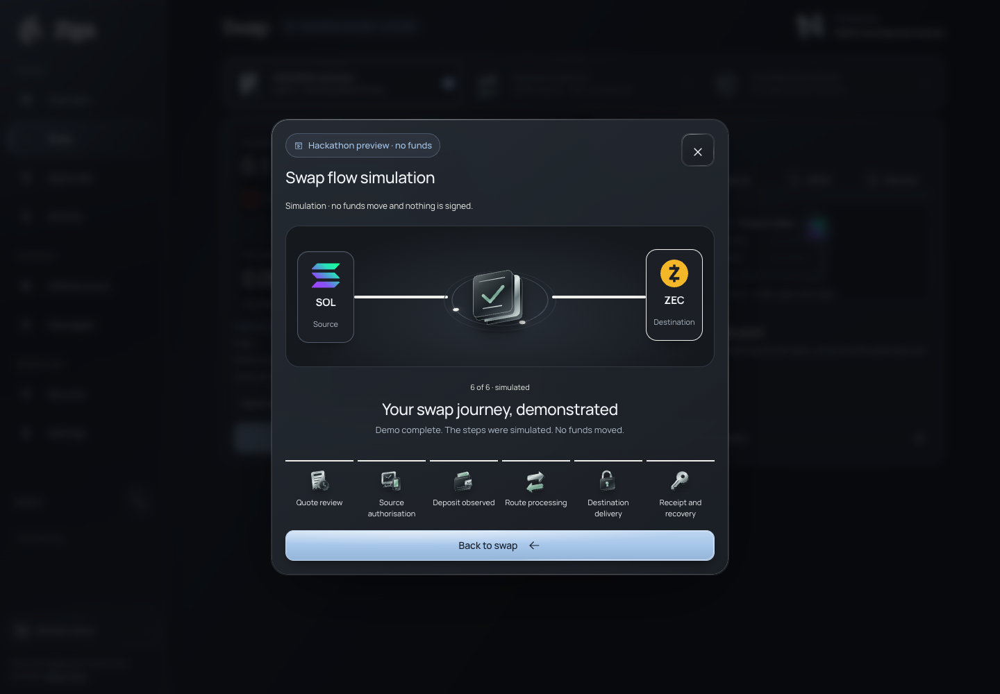

# NEAR judge demo

A reproducible walkthrough of live NEAR price discovery and Zigs' cross-chain swap experience,
without keys, wallet creation or funds. [Project overview](../README.md) · [Integration scope](near-hackathon.md).

## Start locally

Requirements: Node.js 26, npm, a desktop browser and internet access to obtain a real quote.
The checked-in project includes the wallet artifacts; the isolated preview does not load them.
It requires no Rust build or deployment credentials.

From the repository root:

```sh
npm ci --prefix web
npm run build --prefix web
node solspike/tools/swap_preview_server.mjs
```

Keep that terminal open and visit:

```text
http://127.0.0.1:8856/__swap_preview__?scenario=hackathon
```

The server listens on loopback only. Stop it with Ctrl+C. If the port is occupied:

```sh
ZIGS_SWAP_PORT=8857 node solspike/tools/swap_preview_server.mjs
```

Then open the same path on port 8857. A private GitHub repository requires collaborator access
to clone; making this entry publicly accessible is a separate owner decision.

## Walkthrough: do this, see that

| Step | Action | Expected result |
| --- | --- | --- |
| 1 | Open the URL above. | Swap page with **Hackathon preview · no funds**, an example wallet, and real execution choices disabled. |
| 2 | Enter **0.1** in the SOL amount field. | A real NEAR price estimate, minimum received and estimated time. Amount/provider restrictions can instead produce an explicit error. |
| 3 | Open slippage and quote details. | The rate, minimum output and selected tolerance remain visible; a quote is an estimate, not a payment. |
| 4 | Select **Source**, **Deposit**, **NEAR** and **Receive** beside the form. | A separate explanation of each privacy boundary. Open **Privacy details, refunds and recovery** for the longer disclosure. |
| 5 | Use the primary swap action to open review. | A review of the quote and a **Simulate swap flow** button. No live deposit or signing request is created. |
| 6 | Choose **Simulate swap flow**. | A modal explicitly labeled as a simulation. |
| 7 | Use **Next demo step** through all six steps. | Quote review → source authorisation → deposit observed → route processing → destination delivery → receipt and recovery. |
| 8 | Finish the simulation. | **Your swap journey, demonstrated** and **Demo complete. The steps were simulated. No funds moved.** |



*Actual interface capture. All approval, deposit, settlement and recovery stages above are
simulated. The live request was only an unfunded price quote.*

The walkthrough does not prove that a group signed or that either chain settled a transaction.
To inspect the implemented full-wallet payment paths, follow the [source map](near-hackathon.md#implementation-map).

## If something fails

- **No quote / provider error:** check internet access, refresh and use an amount above the
  provider's displayed minimum. The server has a bounded upstream timeout; it never fabricates
  a fallback price. Do not switch to a funded mode to repair this demo.
- **Missing OpenGlass bundle:** run `npm ci --prefix web` and `npm run build --prefix web` before
  starting the preview. The build should produce `web/openglass-dist/app.js`.
- **Address already in use:** choose another `ZIGS_SWAP_PORT` as shown above; leave other local
  servers alone.
- **A real wallet is requested:** use the exact `scenario=hackathon` URL. Other fixture paths
  exercise different flows; the production wallet has its own setup.
- **Motion differs:** reduced motion uses manual steps. The privacy animation is an explainer,
  not live transaction progress.

## Optional live-quote diagnostic

This asks NEAR directly for an unfunded public-route quote using fixed public sample addresses,
checks the provider signature and writes a bounded diagnostic to the ignored local state folder:

```sh
node solspike/tools/near-confidential-probe.mjs --unauthenticated --mode public \
  --output solspike/.state/near-public-quote.json
```

Inspect the summary's HTTP result, `signatureValid` and `verified`. The command exits nonzero
if verification fails. A failure is not a reason to invent a result or send funds. Its requests
are `dry: true`; it creates no deposit, sends no transaction and does not read a partner key.
Do not use other credential modes for the judge demo.

## Two-minute recording outline

| Time | Show | Explain |
| --- | --- | --- |
| 0:00–0:15 | Swap page and preview badge. | A shared treasury should retain its approval rules when moving across chains. |
| 0:15–0:40 | Enter an amount and open quote details. | This is a real mainnet price quote from NEAR Intents through 1Click; no funds have moved. |
| 0:40–1:05 | Source, deposit, NEAR and receive chapters. | Privacy changes at each boundary; confidential routing does not make the entire path invisible. |
| 1:05–1:40 | Review and step through the simulation. | Zigs brings review, group authorization, deposit, processing and recovery into one flow. These stages are simulated here. |
| 1:40–2:00 | Completion screen, then the scope document. | Separate the demonstrated quote from the implemented full-wallet paths and the unverified funded settlement. |

Record only the browser content in a clean profile, with synthetic wallet names. Keep account
profiles, notifications, terminals, recovery material and credentials out of the frame.
